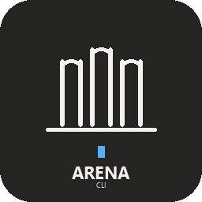
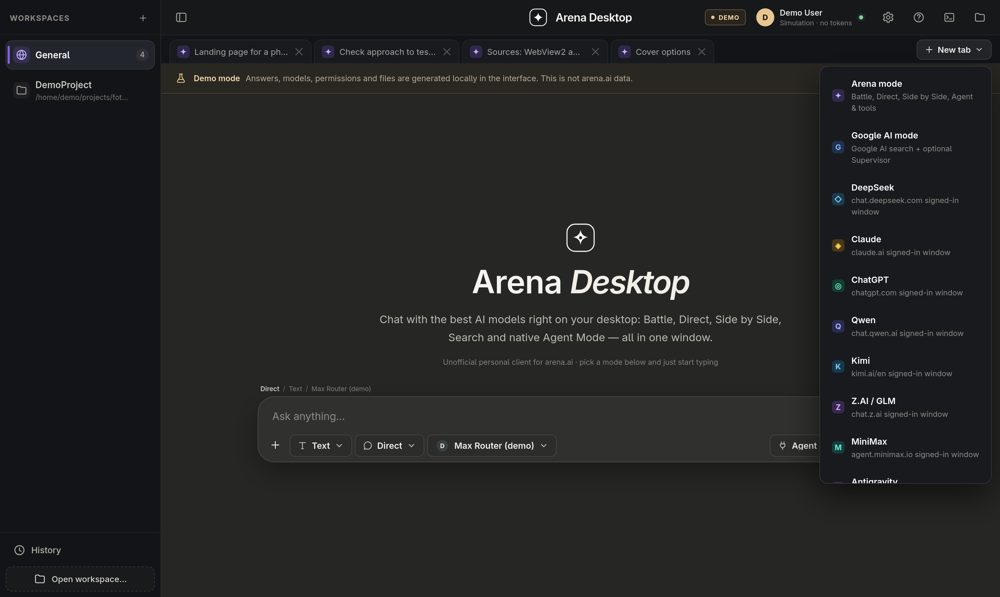
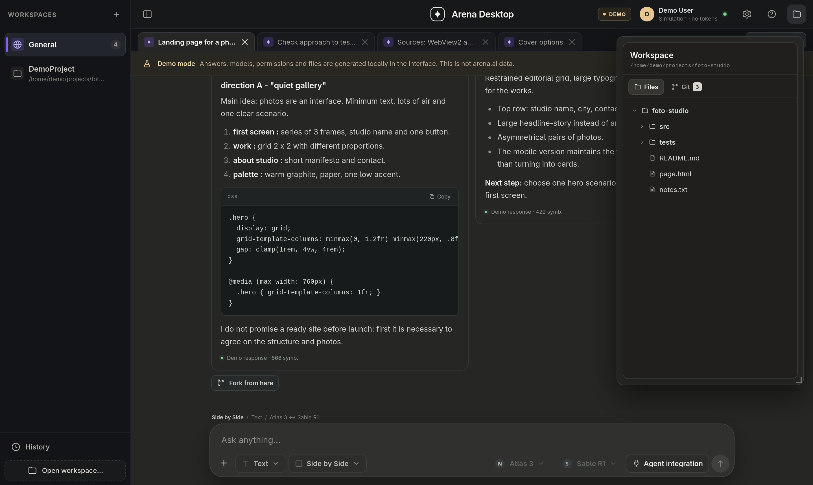
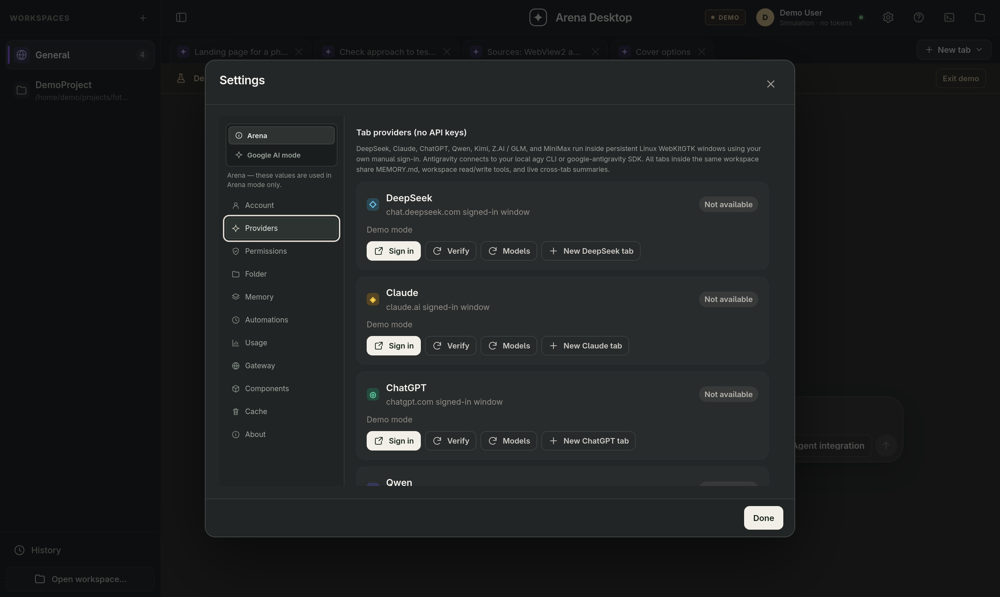
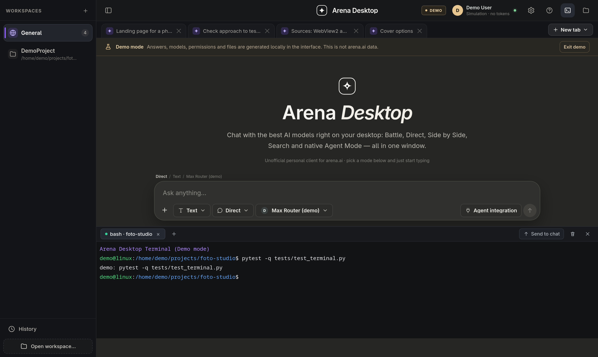

<p align="center">
  
</p>

<h1 align="center">Arena Desktop</h1>

<p align="center">
  <b>A native Linux desktop client for <a href="https://arena.ai">arena.ai</a> — chat, battles, Agent Mode,
  MCP tools, and local workspace integration in one WebKitGTK window.</b>
</p>

<p align="center">
  
  
  
  
  <a href="LICENSE"></a>
</p>

<p align="center">
  
</p>

> [!IMPORTANT]
> Arena Desktop is an **unofficial community client** and is not affiliated with or endorsed by Arena AI Inc.
> All model generation runs on `arena.ai` with your own account. Human verification checks are always
> completed manually by you.

---

## Overview

Arena Desktop wraps `arena.ai` and multi-provider AI tabs in a native Linux desktop app (`pywebview` + `WebKitGTK 4.1`) paired with local developer tools:

- **Workspace-First Multi-Provider Tabs**: Organize tabs by project folder in the left **Workspaces** sidebar and open **Arena (`✦`)**, **Google AI mode (`G`)**, **DeepSeek (`◇`)**, **Claude (`◈`)**, **ChatGPT (`◎`)**, **Qwen (`Q`)**, **Kimi (`K`)**, **Z.AI / GLM (`Z`)**, **MiniMax (`M`)**, and **Google Antigravity (`▲`)** tabs side-by-side — with live per-provider model selection, native Google OAuth popups, shared `MEMORY.md` / `AGENTS.md`, and live cross-tab summaries.
- **Built-in Native Linux Terminal Emulator**: VS Code-style resizable bottom PTY drawer (`` Ctrl+` ``) powered by vendored offline `xterm.js` and real Linux pseudo-terminals (`pty`/`termios`), supporting multiple shell tabs, full-screen TUIs (`vim`, `htop`, `btop`), and one-click **Send to chat**.
- **All Arena modes**: Battle, Side by Side, Direct, and native **Agent Mode** (plus a built-in Local Agent backend).
- **All modalities**: Text, Code, Web Search, Image, Video, and Auto, following `arena.ai`'s rules and live model catalog (400+ models).
- **Workspace Sync & Local Tools across Providers**: Grant Arena, DeepSeek, Claude, ChatGPT, Qwen, Kimi, Z.AI / GLM, MiniMax, and Antigravity controlled access (`ls`, `read_file`, `read_files`, `search`, `write_file`, `edit_file`, `mkdir`, `delete`, `run_cmd`) to a chosen project folder under strict permission modes (`Plan`, `Ask`, `Accept edits`, `Auto`, `Bypass`), with automatic file checkpoints and one-click Undo.
- **MCP Servers & Agent Gateway**: Connect local STDIO MCP servers (presets, JSON, or CLI commands), toggle official Arena account connectors, and expose selected local MCP tools or your Workspace folder to the native Arena Agent through a temporary, pairing-protected Cloudflare Quick Tunnel (`cloudflared`).
- **Native Linux Desktop Integration**:
  - **Secret Service encryption** (`ARENA-SECRET-v1:` AES-256-GCM via GNOME Keyring / KDE KWallet `secret-tool`, falling back to `0600` files in headless setups).
  - **One-click Linux `cloudflared` installer** (official `x86_64` / `arm64` static binary, SHA-256 verified).
  - **Chromium-family cookie import** (Chrome, Chromium, Brave, Edge, Vivaldi, and Flatpak profiles, supporting both `v11` keyring-encrypted and `v10` cookies).
  - **XDG `arenadesktop://` deep links**, `xdg-open` folder/config openers, native `notify-send` desktop notifications, optional system tray, and Wayland/X11 clipboard support.

---

## Key Features

### Chat, Models & Multi-Account Workflow
- **Battle Mode** with anonymous A/B responses, real voting (**A / B / Tie / Both bad**), and model reveal after voting.
- **Direct & Side by Side** with searchable live model picker, favorites, hidden models, Vision/Docs capability badges, and optional leaderboard Elo.
- **Multi-model fan-out** (ask 2–4 models in parallel with an automated comparison summary).
- **Parallel chats** with independent Stop controls, per-chat drafts, message queueing, full-text search, fork from any message, **Compact** context rollover, and Markdown / standalone HTML export.
- **Multiple accounts** with isolated chat lists, one-click switching, cloud history sync (`Refresh from Arena`), and delete-with-Arena-archive.
- **Command Palette (`Ctrl+K`)**, in-chat search (`Ctrl+F`), resizable panels, and a **Workspace Git tab** (status, diff, stage/unstage, local commit).

### Agent & Workspace Capabilities
- **Native Arena Agent**: Streams natively in-app with structured `ask_user` cards, image choices, voice auditions, Workspace Sync file downloads, and up to 6 parallel native sub-agents.
- **Local Agent**: Supports `propose_plan` approval cards, `set_todos` live checklists, `ask_user` prompts, parallel read-only sub-agents, `AGENTS.md` + `MEMORY.md` project memory with live cross-tab summaries, and plan-only scheduled automations.
- **Rich Workspace Previews**: Scriptless/CSP-sandboxed HTML previews, rendered Markdown, inline images/audio/video/PDF, and read-only code views.
- **Local Security**: Per-instance local API token (`X-Arena-Token`), loopback-only host/origin enforcement, path-traversal protection, and constant-time pairing auth on the Agent Gateway.

<p align="center">
  
</p>

<p align="center">
  
</p>

<p align="center">
  
</p>

---

## Installation (Linux)

Download the latest release from [GitHub Releases](https://github.com/GeneticxCln/Arena-Desktop-Linux/releases):

| Format | Package | Install Command |
| --- | --- | --- |
| Debian / Ubuntu | `arena-desktop_<version>_amd64.deb` | `sudo apt install ./arena-desktop_<version>_amd64.deb` |
| Fedora / openSUSE | `arena-desktop-<version>-1.x86_64.rpm` | `sudo dnf install ./arena-desktop-<version>-1.x86_64.rpm` |
| Arch / CachyOS / Manjaro | `arena-desktop-<version>-1-x86_64.pkg.tar.zst` | `sudo pacman -U arena-desktop-<version>-1-x86_64.pkg.tar.zst` |
| Portable (any distro) | `Arena-Desktop-<version>-linux-x86_64.AppImage` | `chmod +x Arena-Desktop-*.AppImage && ./Arena-Desktop-*.AppImage` |
| Manual tarball | `Arena-Desktop-linux-x86_64.tar.gz` | Extract and run `./install-linux.sh` or `./Arena-Desktop` |

### System Runtime Requirements

WebKitGTK 4.1 and GTK 3 are required system packages:

| Distribution | Packages |
| --- | --- |
| Arch / CachyOS / Manjaro | `sudo pacman -S --needed webkit2gtk-4.1 python-gobject` |
| Debian / Ubuntu | `sudo apt install python3-gi gir1.2-webkit2-4.1 gir1.2-gtk-3.0` |
| Fedora | `sudo dnf install python3-gobject gtk3 webkit2gtk4.1` |
| openSUSE | `sudo zypper install python3-gobject WebKit2GTK-4.1` |

See [`README_LINUX.md`](README_LINUX.md) for detailed packaging, troubleshooting, and optional tool notes (`secret-tool`, `notify-send`, `wl-paste`/`xclip`).

---

## Run or Build from Source

```bash
python3 -m venv --system-site-packages .venv
.venv/bin/pip install -r requirements.txt
.venv/bin/python arena-cli.py          # Desktop GUI
.venv/bin/python arena-cli.py --cli    # Terminal CLI
```

Build the single-file ELF binary and all Linux distribution packages:

```bash
./build-linux.sh                # checks + pytest + PyInstaller ELF + .tar.gz
./packaging/build-packages.sh   # .deb, .rpm, Arch .pkg.tar.zst, AppImage, SHA256SUMS
```

App data (settings, chats, accounts, logs) lives in `~/.arena-personal/` (or `./data` next to the binary when `portable.txt` is present).

---

## Testing

```bash
.venv/bin/pip install -r requirements-dev.txt
.venv/bin/python -m pytest -q tests --ignore=tests/test_ui_browser.py --ignore=tests/test_v58_browser.py
node --check arena/web/static/app.js
xvfb-run -a .venv/bin/python scripts/smoke_linux.py dist/Arena-Desktop
```

A built-in demo mode (`?demo=1`) simulates chats, models, and tools locally for UI development without an account.

---

## Architecture

```
┌─────────────────────────── Arena Desktop (pywebview / WebKitGTK) ───────────────────────────┐
│  Single-page UI  ──►  local Flask API + SSE streaming  (arena/web/)                         │
│                              │                                                              │
│        ┌─────────────────────┼──────────────────────────┐                                   │
│        ▼                     ▼                          ▼                                   │
│  arena.ai engine      native Arena Agent         local tool loop                            │
│  (WebKitGTK window,   (agentic API, resumable    (arena/agent.py + MCP via                  │
│   real session)        + Gateway tunnel)          arena/connectors.py)                      │
└─────────────────────────────────────────────────────────────────────────────────────────────┘
```

| Module | Role |
| --- | --- |
| `arena/desktop.py` | Native Linux window shell (`pywebview` + WebKitGTK 4.1 / Qt fallback), tray, `notify-send` |
| `arena/web/app.py` | Local Flask API, SSE streaming, chat/account orchestration, Workspace Git & previews |
| `arena/web/static/` | Vanilla HTML/CSS/JS SPA (no npm/bundler/CDN) |
| `arena/engine.py` | Hidden `arena.ai` WebKitGTK window executing signed-in requests |
| `arena/contracts.py` | `arena.ai` wire formats, stream parsing, upload validation |
| `arena/native_agent.py` | Native Arena Agent Mode protocol + `arena/native_subagents.py` |
| `arena/agent.py` | Local folder-tools loop (`/bin/sh -lc`, idle watchdog, checkpoints) |
| `arena/gateway.py` | Loopback Agent Gateway + Cloudflare Quick Tunnel manager |
| `arena/connectors.py` | Local STDIO MCP server manager |
| `arena/components.py` | Linux component detection (`WebKitGTK 4.1`, `Python`, `Node.js`, SHA-256 `cloudflared` installer) |
| `arena/crypto.py` | Linux Secret Service (`ARENA-SECRET-v1:` AES-256-GCM) credential protection |
| `arena/deep_links.py` | XDG `arenadesktop://` protocol registration and single-instance handoff |
| `arena/permissions.py` | Permission modes and per-chat approval broker |
| `arena/models.py` | Dynamic `arena.ai` model catalog |
| `arena/history_sync.py` | Cloud-to-local chat history conversion & merge |

---

## Limitations

- **Linux-only**: Targets Linux desktops with WebKitGTK 4.1 (or QtWebEngine fallback).
- **Arena limits apply**: Daily spend caps, modality/model rate limits, and account gates are enforced server-side by `arena.ai`.
- **Manual human checks**: Verification challenges open in the embedded window for you to complete manually.
- **Code mode sandbox**: Arena's remote Code sandbox only sees files it created/edited there (see [`KNOWN_ISSUES.md`](KNOWN_ISSUES.md)).

---

## License

Released under the [MIT License](LICENSE). Not affiliated with Arena AI Inc.
For bugs and feature requests, use [GitHub Issues](../../issues).
